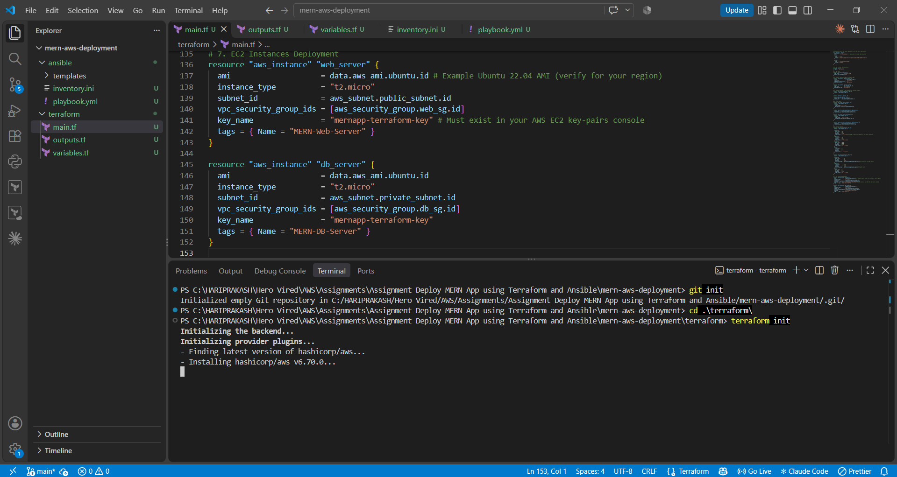
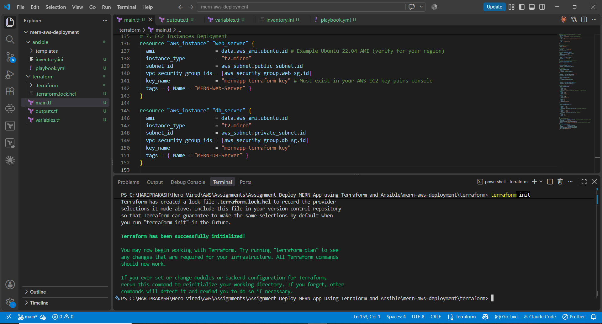
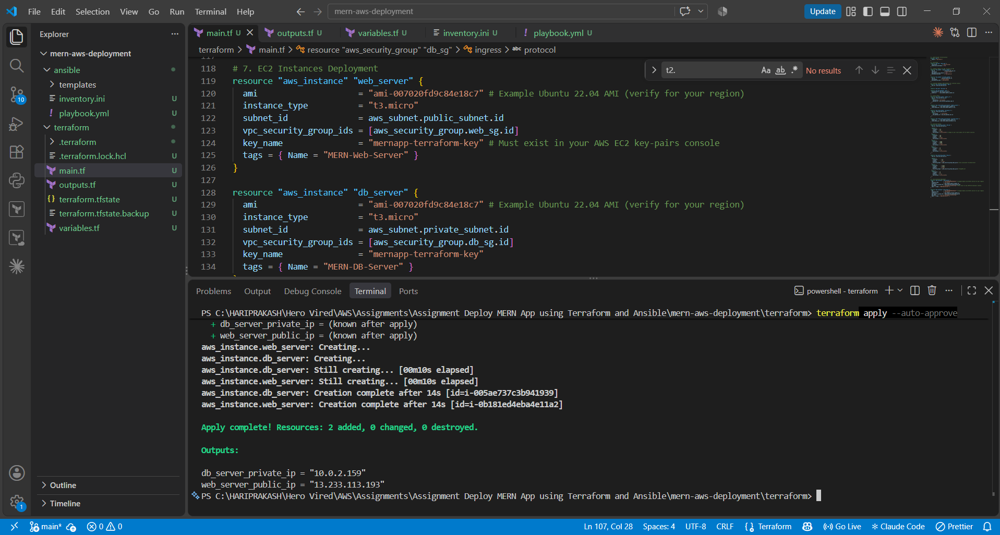
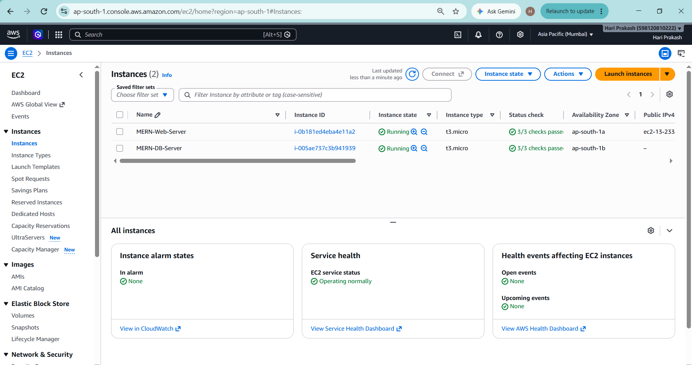
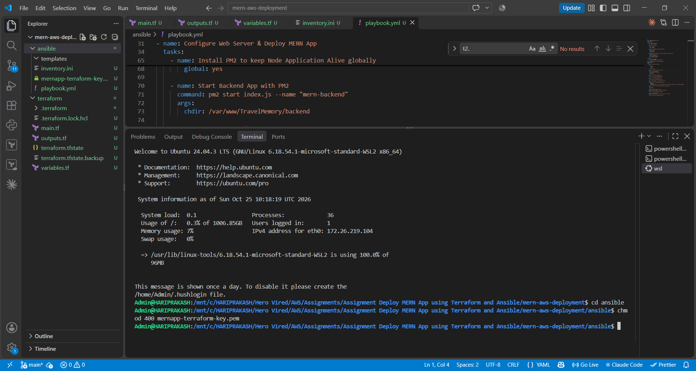
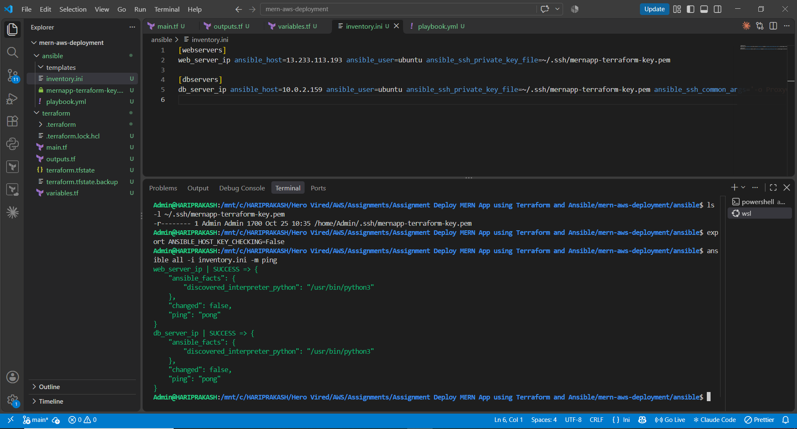
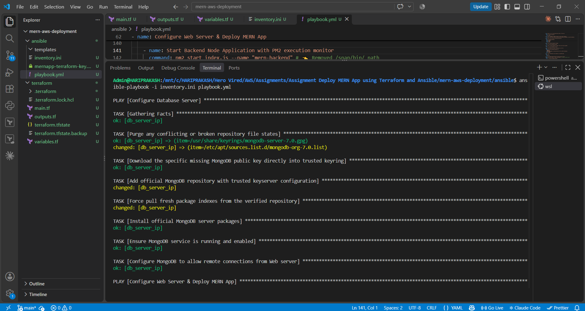
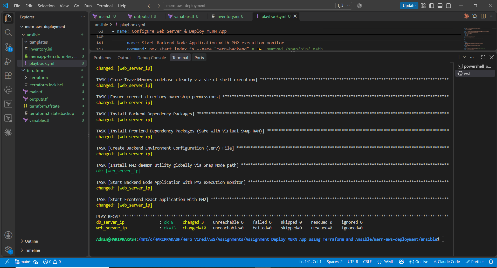
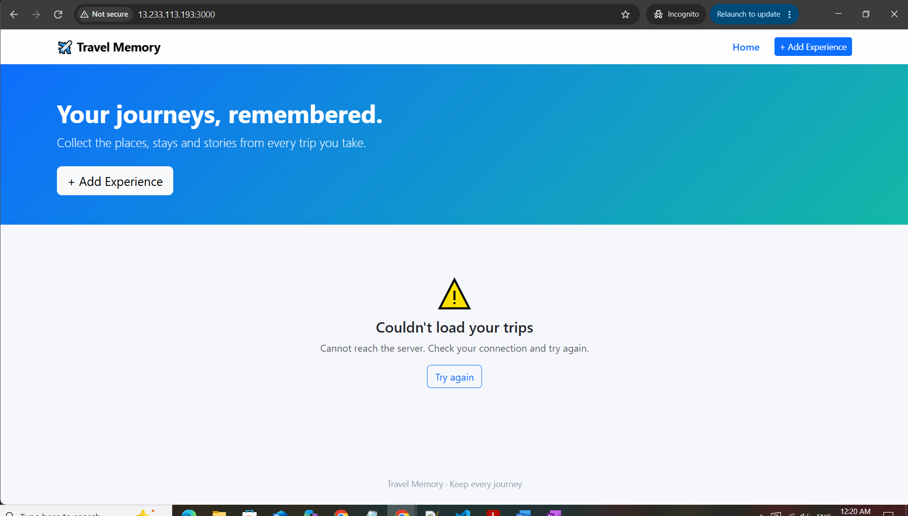
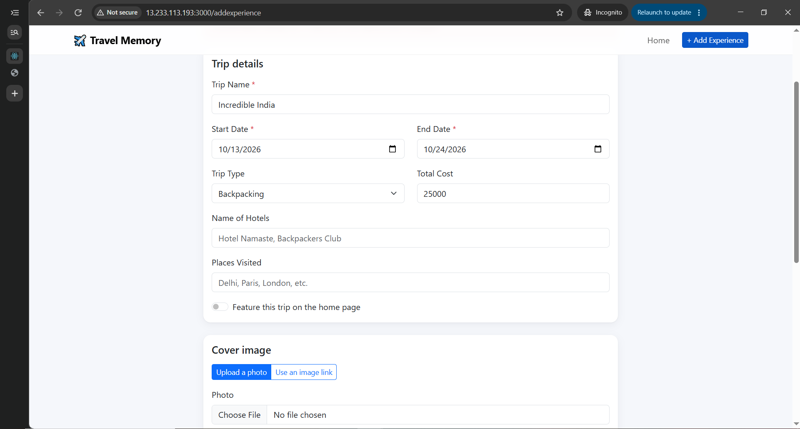

# Multi-Tier Automated MERN Stack Deployment on AWS Cloud
> **Course Assignment Report:** Infrastructure as Code (IaC) & Configuration Management Automation Workflow.

---

## 1. Architectural Engineering Overview
This deployment establishes a secure, production-grade, multi-tier hosting architecture inside the Amazon Web Services (AWS) Mumbai region (`ap-south-1`). The deployment orchestrates a fully separated network topology dividing application interfaces from persistence layers using automated scripts.

| Layer Tier | Component Engine | Subnet Classification | Networking Ports | Security Exposure Strategy |
| :--- | :--- | :--- | :--- | :--- |
| **Presentation** | React.js Web Client | Public Subnet (`10.0.1.0/24`) | `TCP 3000` | Open to Global Internet Traffic (`0.0.0.0/0`) |
| **Application** | Node.js / Express API | Public Subnet (`10.0.1.0/24`) | `TCP 3001` | Restricted API Routing Interface Traffic Gateway |
| **Database** | MongoDB 7.0 Server | Private Subnet (`10.0.2.0/24`) | `TCP 27017` | Isolated; Accepts Inbound Web Server Traffic Only |

---

## 2. Infrastructure Automation Blueprint (Terraform Phase)
Terraform initializes cloud provider parameters programmatically to construct the software-defined data center (SDDC).

### Provisioned Cloud Resources:
* **Custom VPC:** A dedicated `10.0.0.0/16` isolated cloud network workspace.
* **Subnets Matrix:** Provisioned 1 Public Subnet for web routing and 1 isolated Private Subnet for database retention.
* **Routing Gates:** Configured an Internet Gateway (`IGW`) combined with dynamic route routing tables to tie public traffic securely.
* **Firewall Security Groups:** 
  * `web_sg`: Exposes port 22 (SSH Management), 3000 (React), and 3001 (Express Backend API).
  * `db_sg`: Strictly maps port 27017, filtering entry exclusively to packets coming out of `web_sg`.

* **Terraform Initialise:** 
>
> 
>
> 
>
> 

### 📷 [STEP 1 SCREENSHOT] Cloud Infrastructure Status Verification
> **Instructions for Submission:** Go to your AWS EC2 Web Console. Take a screenshot showing both your **MERN-Web-Server** and **MERN-DB-Server** instances running cleanly together in the Mumbai region with their private/public IP mappings visible.
>
> 

---

## 3. Configuration Management & Codebase Rollout (Ansible Phase)
Ansible maps server configuration steps across the verified infrastructure over an SSH proxy tunnel using your native security key file (`mernapp-terraform-key.pem`).

### Executed Configuration Plays:
1. **Database Engine Rollout:** Connects to the private instance, imports official repository GPG signatures directly from `://ubuntu.com`, downloads core `mongodb-org` packages, and overrides binding rules to `0.0.0.0`.
2. **Web Layer Orchestration:** Configures the public instance, sets up stable Node.js 20 LTS environments via Snap, builds a 2GB virtual swap file to prevent memory exhaustion, and clones the *TravelMemory* repository.
3. **Daemon Production Management:** Generates optimized system environmental configurations (`.env`) matching live cluster addresses and executes background processing loops using `nohup` / `PM2` managers.

### 📷 [STEP 2 SCREENSHOT] Automation Terminal Execution Success
> **Instructions for Submission:** Take a screenshot of your VS Code terminal window showing the final successful **PLAY RECAP** output from your `ansible-playbook -i inventory.ini playbook.yml` run where `failed=0` is printed across all nodes.
>
> 
>
> 
>
> 
> 
> 

---

## 4. Live Production Verification (MERN Stack Active)
The full-stack application communicates across subnets flawlessly. When a user creates a card, the React UI queries the Express API engine over public port 3001, which writes the metadata records directly over the secure private network into the backend MongoDB cluster.

### 📷 [STEP 3 SCREENSHOT] Operational Application Submission Portal
> **Instructions for Submission:** Open an Incognito Window and load your application interface at `http://13.233.113.193:3000`. Click on **"+ Add Experience"**, fill out a dummy travel destination entry, and save it. Take a screenshot showing the dashboard interface rendering your added trip card successfully without any connectivity error blocks.
>
> 
---
> 
---

## 5. Teardown Procedures (Cost Remediation)
To prevent unexpected cloud account tracking metrics charges on your AWS Free Tier allowance quota once evaluation is finalized, tear down the architecture using this direct single-line pipeline command inside your local project terminal workspace directory:

```bash
cd terraform/ && terraform destroy --auto-approve
```
